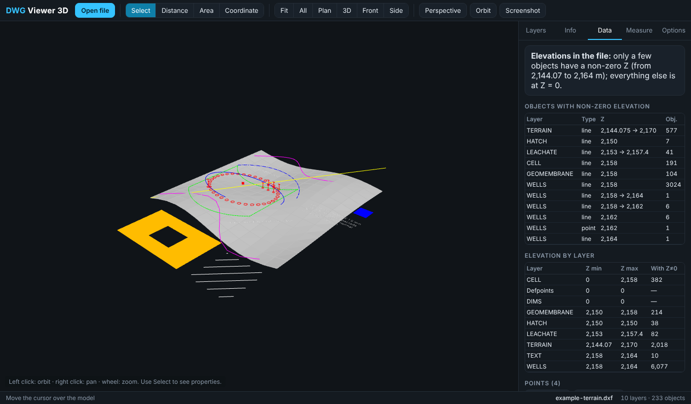

# DWG Viewer

**Open AutoCAD `.dwg` / `.dxf` drawings without AutoCAD** — in your browser, offline, or straight from Claude.



- **One-file viewer** (`dwg-viewer.html`, ~4 MB): double-click, drop a DWG on it. No install, no server, no upload — the file never leaves your device.
- **Claude skill / plugin**: upload a DWG to Claude and it reads it for you — layers, real coordinates, **elevations**, points, texts — and hands back a plan-view SVG and a ready-to-open 3D viewer with your drawing embedded.
- **CLI** (`dwg-tool`): the same engine for scripts and pipelines.

> DWG is Autodesk's proprietary format. Decoding uses the open-source [LibreDWG](https://www.gnu.org/software/libredwg/) (compiled to WebAssembly), so fidelity is high but **not 100 %** — see [Limitations](#limitations).

## Contents
[Quick start](#quick-start) · [Install in Claude](#install-in-claude) · [What it shows](#what-it-shows) · [CLI](#cli) · [Build from source](#build-from-source) · [How it works](#how-it-works) · [Limitations](#limitations) · [Privacy](#privacy) · [License](#license)

## Quick start

### Just view a drawing
1. Download `dwg-viewer.html` from the [latest release](https://github.com/OWNER/dwg-viewer/releases/latest) (`dwg-viewer-es.html` for a Spanish UI).
2. Open it in Chrome, Edge, Firefox or Safari (a recent version — it needs `DecompressionStream`).
3. Drag your `.dwg` / `.dxf` onto the page, or press **Open file**. Works with no internet.

Controls: left mouse orbits · right mouse pans · wheel zooms to the cursor · touch: one finger orbits, two zoom/pan · `F` fit · `T` plan · `I` 3D · `Esc` cancel.

### Use it from Claude
Install the skill (below), then just attach a DWG and say *"open this and tell me what's in it"*. Claude runs the bundled CLI locally and sends you the viewer.

## Install in Claude

### Claude Code (plugin marketplace)
```text
/plugin marketplace add OWNER/dwg-viewer
/plugin install dwg-viewer@dwg-viewer
```
Restart/reload, then attach any `.dwg` or `.dxf` and ask about it.

### Claude.ai / Claude desktop (skill upload)
1. Download `dwg-viewer-skill.zip` from the [latest release](https://github.com/OWNER/dwg-viewer/releases/latest).
2. **Settings → Capabilities → Skills → Upload skill** and pick the zip. (Code execution must be enabled.)
3. Attach a DWG to a chat: *"Open this drawing and summarize it."*

### Manually (any Claude with a skills folder)
Copy the `skills/dwg-viewer/` folder into your skills directory (e.g. `~/.claude/skills/`).

The skill needs **Node.js ≥ 20** in Claude's sandbox and nothing else: the CLI is a single bundled file with the WebAssembly decoder next to it — no `npm install`, no network.

## What it shows

| | |
|---|---|
| **Geometry** | LINE, ARC, CIRCLE, ELLIPSE, LWPOLYLINE, POLYLINE (2D/3D, meshes), SPLINE (NURBS), 3DFACE, SOLID/TRACE, POINT, LEADER, HATCH (islands, patterns), TEXT/MTEXT/ATTRIB, INSERT (nested blocks, arrays), DIMENSION |
| **Appearance** | Layer colors, ByLayer/ByBlock, ACI + true color, linetypes (dashes), layer on/off/frozen, hatch fills |
| **3D** | Real X/Y/Z, perspective/orthographic, plan/front/side/3D views, vertical exaggeration |
| **Data tab** | Elevation range per layer, objects with Z ≠ 0, table of all points (E, N, Z) with click-to-zoom and **CSV download**, block attributes (e.g. names from KML imports) |
| **Tools** | Pick objects (properties), distance (3D, horizontal, slope, azimuth), plan area/perimeter, real coordinates, snapping to vertices/endpoints/centers, screenshot |
| **Numeric safety** | Recenters huge coordinates (UTM, state plane) internally so nothing jitters; real coordinates are shown everywhere |

**Elevations, honestly.** Many DWGs are flat (all Z = 0 — KML/GIS exports, survey sheets). The viewer never invents altitudes: the Data tab and `dwg-tool info` say when a drawing is flat and list exactly which objects carry a Z. Points with Z = -999999 (a common "no elevation" marker) are treated as 0. Spot heights written only as text are exported by `dwg-tool texts`.

## CLI

```bash
# from a checkout (after npm ci) or straight from the packaged skill folder
node skills/dwg-viewer/scripts/dwg-tool.mjs info   drawing.dwg            # markdown summary (add --json)
node skills/dwg-viewer/scripts/dwg-tool.mjs points drawing.dwg --layer "Wells" --out wells.csv
node skills/dwg-viewer/scripts/dwg-tool.mjs texts  drawing.dwg --out texts.csv
node skills/dwg-viewer/scripts/dwg-tool.mjs plan   drawing.dwg --out plan.svg [--light]
node skills/dwg-viewer/scripts/dwg-tool.mjs viewer drawing.dwg --out drawing-viewer.html [--lang es]
```
`viewer` writes a standalone page with the drawing embedded (gzip + base64); open it anywhere, offline. Without an input file it writes an empty drag-and-drop viewer.

## Build from source

```bash
git clone https://github.com/OWNER/dwg-viewer && cd dwg-viewer
npm ci
npm test                 # CLI + jsdom UI smoke tests on synthetic drawings (DWG R2000…2018, DXF)
npm run build:all        # dist/dwg-viewer.html, dist/dwg-viewer-es.html, refreshes skills/dwg-viewer/
npm run package:skill    # dist/dwg-viewer-skill.zip (needs `zip`)
CHROME_PATH=/usr/bin/google-chrome npm run test:browser   # optional real-browser WebGL check
```

Language: English is the source language. `npm run build:es` swaps every UI string using [`i18n/pairs.mjs`](i18n/pairs.mjs) to produce the Spanish build; add a language by adding a table of pairs.

## How it works

```
 .dwg ──LibreDWG (wasm)──┐
                         ├─► src/model.js   normalized CAD model
 .dxf ──dxf-json─────────┘        │
                                  ▼
                          src/geom.js       geometry engine (no DOM): layers, blocks, hatches,
                                  │         splines, units, origin recentering, snap points
              ┌───────────────────┼─────────────────────┐
              ▼                   ▼                     ▼
        src/viewer.js        src/datos.js          src/svg.js
        three.js 3D view     elevations/points     plan-view SVG
              │                   │                     │
        dist/dwg-viewer.html      └──── cli/dwg-tool.mjs ┘  (bundled into the skill)
```

The viewer page inlines everything: the bundle, the gzip'd WebAssembly decoder and (optionally) your drawing, so it runs from `file://` with zero network access.

## Limitations

- **Not 100 % faithful.** Reverse-engineered decoder; always check critical work in AutoCAD / a licensed viewer.
- **Not drawn:** 3DSOLID/ACIS solids, proxy objects (e.g. Civil 3D), tables, multileaders, images/OLE. Lineweights are ignored; complex linetypes become simple dashes. The *Info* tab lists every skipped object type for the open file.
- In DWG files, 2D **TEXT/HATCH/SOLID lose their elevation** (the decoder doesn't expose it): they sit at the drawing's median Z. Plan view is unaffected.
- Very large DWGs (hundreds of MB) can exhaust WebAssembly memory. Hide layers or export a lighter DXF.
- Binary DXF isn't supported — save as ASCII DXF.
- If a DWG fails: in AutoCAD use `SAVE AS → DXF (2013/2018)`, or convert with the free [ODA File Converter](https://www.opendesign.com/guestfiles/oda_file_converter), then open the DXF.

## Privacy

Everything runs locally (browser or Node). Drawings are never uploaded anywhere by this project. A viewer page built with `dwg-tool viewer` **contains your drawing's data** — treat it like the drawing itself before sharing it. The repo's `.gitignore` blocks `*.dwg`/`*.dxf` (except the synthetic files in `samples/`) so you don't commit project files by accident.

## License

GPL-3.0-or-later — see [LICENSE](LICENSE). The bundled WebAssembly decoder is LibreDWG (GPL-3.0), which makes the combined work GPL. Other components: [three.js](https://threejs.org) (MIT), [@mlightcad/libredwg-web](https://github.com/mlightcad/libredwg-web) (GPL-3.0), [@mlightcad/dxf-json](https://github.com/mlightcad/dxf-json) (GPL-3.0).

AutoCAD, DWG and DXF are trademarks of Autodesk, Inc. This project is independent and not affiliated with or endorsed by Autodesk.
